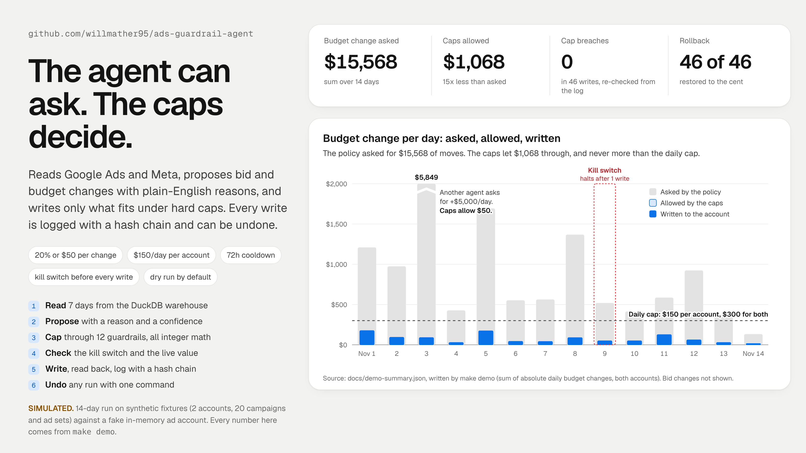
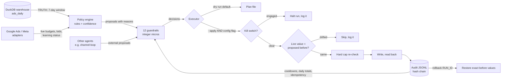

# ads-guardrail-agent

**An agent that reads Google Ads and Meta, proposes bid and budget changes in plain English, and writes only what fits under hard caps.**



> **What's real and what isn't**
>
> | Part | Status |
> |---|---|
> | Policy engine, guardrails, kill switch, audit log, rollback, CLI, scheduler entrypoint | **Real, working code**, tested (66 tests, 600+ generated cap cases) |
> | Google Ads and Meta connectors | **Real request and response shapes** (GAQL searchStream, `campaignBudgets:mutate`, Graph API insights and ad set updates). Tested against a fake transport. **Never run against a live account from this repo.** |
> | Fixture data: 2 accounts, 20 campaigns and ad sets, 60 days | **Synthetic.** Generated by `fixturegen.py`, labeled `_synthetic`, stored in the platforms' own JSON shapes |
> | The 14-day demo and every number in the hero and Results | **Simulated.** A market simulator with hidden response curves, writing to a fake in-memory account |
> | DuckDB warehouse | **Real DuckDB.** Loaded with the synthetic data in the demo |
>
> No ad spend, no live writes, no API keys in this repo. Live use needs your own credentials and two explicit switches.

## Why this exists

Cody Schneider's frame for marketing agents is four parts: **TRUTH** (live warehouse data), **HANDS** (ad and CMS APIs behind limits), a **HOME** (it runs on a schedule, all the time) and **TOOLS**. Then the channel system should improve itself from the data stream.

This repo is mostly the **HANDS behind limits** part. It is the piece that makes it safe to let an agent touch ad budgets at all.

| | What this repo supplies |
|---|---|
| **TRUTH** | Reads daily metrics from a DuckDB table (`ads_daily`) built the same way as [marketing-warehouse](https://github.com/willmather95/marketing-warehouse). Falls back to the ad APIs if the table is missing. |
| **HANDS** | Google Ads and Meta adapters behind one interface, wrapped in 12 guardrails, a kill switch, and an append-only audit log with rollback. **This is the core of the repo.** |
| **HOME** | `ads-guardrail tick` is a scheduler entrypoint with exit codes. Cron and GitHub Actions examples are in [`examples/`](examples/). Re-runs are idempotent. |
| **TOOLS** | A small Python API (`propose`, `apply`, `rollback`) that other agents import. It is built for [channel-loop](https://github.com/willmather95/channel-loop) to import. |

## Quickstart (no credentials, under 2 minutes)

```bash
git clone https://github.com/willmather95/ads-guardrail-agent && cd ads-guardrail-agent
make demo        # makes .venv, installs, runs the SIMULATED 14-day demo
make test        # 66 tests, including property-based cap tests
```

Without `make`:

```bash
python3 -m venv .venv && .venv/bin/pip install -e '.[dev]'
.venv/bin/python -m ads_guardrail demo --out demo/out
.venv/bin/python -m pytest
```

One day, by hand, on the fixture accounts:

```bash
.venv/bin/ads-guardrail --config config/demo.toml run --as-of 2026-11-01 -v           # dry run
.venv/bin/ads-guardrail --config config/demo.toml run --as-of 2026-11-01 --apply      # writes to the fake account
.venv/bin/ads-guardrail audit verify
.venv/bin/ads-guardrail --config config/demo.toml rollback run-2026-11-01-9aae3e78 --apply
.venv/bin/ads-guardrail --config config/demo.toml kill on                            # stop everything
```

What a dry run prints (real output, trimmed):

```
run-2026-11-01-9aae3e78: 11 proposals, 9 holds, source=fixture
[blocked ] Search | Brand                     budget/day     $60.00 ->     $76.53 wanted,     $60.00 allowed  conf 0.94
             why: Raise budget: beating target and limited by budget. Marginal-CPA sizing says x1.28 (last 7 days: CPA $17.64 vs target $25.00, 22 conversions, spent 92% of budget).
             caps: not on the allowlist
[clamped ] Search | Water Heater Repair       budget/day    $250.00 ->    $582.28 wanted,    $300.00 allowed  conf 1.00
             why: Raise budget: beating target and limited by budget. Marginal-CPA sizing says x2.33 (last 7 days: CPA $54.64 vs target $90.00, 31 conversions, spent 97% of budget).
             caps: per-change cap 20% / $50.00 limits it to $50.00
[clamped ] Search | Drain Cleaning            budget/day    $180.00 ->     $54.00 wanted,    $144.00 allowed  conf 0.87
             why: Cut budget: missing target. Marginal-CPA sizing says x0.30 (last 7 days: CPA $111.58 vs target $80.00, 11 conversions, spent 97% of budget).
             caps: per-change cap 20% / $50.00 limits it to $36.00
...
DRY RUN: 5 changes would be written. Nothing was written.
```

## How it works



**1. Read.** Live settings (budget, bid, learning status) come from the platform. Metrics come from the warehouse if `ads_daily` has rows, otherwise from the API. Writes always start from a fresh live read.

**2. Propose.** Each entity gets one of six outcomes. Every proposal carries a reason, an expected daily impact and a confidence.

| Rule | When | Action |
|---|---|---|
| `learning_phase` | platform says the entity is still learning | hold |
| `min_data` | under 5 days, or under 10 conversions and under 3x target CPA in spend | hold |
| `scale_winner` | beats CPA or ROAS target by 15%+, spends 90%+ of budget | raise budget |
| `underpacing_bid_up` | beats target, spends 60% or less, has a bid | raise bid |
| `over_target_bid_down` / `cut_loser` | misses target by 15%+ | lower bid, or cut budget if no bid |
| `within_band` / `not_constrained` | everything else | hold |

Confidence is real statistics, not a vibe score. Conversions are treated as Poisson counts. With a Jeffreys prior, P(true CPA < target) is a Gamma tail probability, computed in [`stats.py`](src/ads_guardrail/stats.py) with no SciPy. Rules act only at 80% or more.

Budget sizing uses marginal CPA. If conversions grow like spend^0.75, the next dollar costs average CPA / 0.75. The policy sizes the budget so the next dollar costs about the target. The policy is allowed to ask for big moves (up to 3x). Cutting them down is the guardrails' job, and the log keeps both numbers.

**3. Cap.** [`guardrails.py`](src/ads_guardrail/guardrails.py) applies these in order. All money is integer micros, so there is no float rounding.

| # | Guardrail | Demo setting |
|---|---|---|
| 1 | Allowlist (fnmatch on `platform:account:entity`; empty = nothing writable) | brand campaign left out |
| 2 | Google shared budgets are never edited (one edit moves many campaigns) | |
| 3 | A proposal id already live is blocked (idempotent re-runs) | |
| 4 | Cooldown per entity | 72 hours |
| 5 | One change per entity per run | |
| 6 | Max changes per run, highest priority first | 5 |
| 7 | Per-change cap: the smaller of % and $ | budget 20% or $50, bid 15% or $10 |
| 8 | Floor | budget $5, bid $1 |
| 9 | Account daily cap: sum of budget moves per account per UTC day | $150 |
| 10 | Account total cap: sum of daily budgets can't rise above it | $2,000 Google, $1,800 Meta |
| 11 | Round to whole cents, toward the old value (never past a cap) | |
| 12 | Minimum change after caps | $1 |

**4. Write.** Two keys are needed: `--apply` (or `apply=True`) **and** `[writes] enabled = true` in config. Before **every** write the executor checks the kill switch, re-reads the live value, re-runs a hard cap check, then writes and reads the value back. Mutations are never retried automatically, so a timeout can't double apply.

**5. Log and undo.** Every event goes to `audit.jsonl`: run start, each block with its reason, each write with before, after, proposal id, rule and reason. Each line holds the previous line's SHA-256, so an edit, deletion or reorder fails `audit verify`. Appends take a file lock and fsync. The log is also the guardrails' memory (cooldowns, daily totals, what is already live). `rollback RUN_ID` restores before values newest first. If someone changed a value since our write, it reports a conflict instead of overwriting it.

## Safety and limits

- **Dry run is the default** everywhere: CLI, Python API and the scheduler example.
- **Kill switch:** `touch KILL_SWITCH`, `ads-guardrail kill on`, or `ADS_GUARDRAIL_KILL=1`. It is read live before each write, during rollback too. A halted run resumes cleanly once released, and nothing is applied twice (tested).
- **Exit codes for schedulers:** 0 ok, 1 error, 3 halted by kill switch, 4 refused (`--apply` without the config flag).
- **Learning phase is protected.** No changes while the platform reports learning. The 20% per-change cap also keeps moves small. In the simulator, I assume a move over 20% restarts learning. That is a common rule of thumb, not a documented platform threshold.
- **Meta rate limits:** the adapter reads `x-business-use-case-usage` and stops at 90% with the platform's wait time.
- **Limits I know about:** one currency per account is assumed. ROAS confidence holds order value at its observed mean. Google Ads access tokens must be refreshed outside this repo. The live connectors are untested against real accounts. Pin `API_VERSION` in each connector to a supported version before a live run.

## Results (SIMULATED, from `make demo`)

These numbers come only from running this repo's demo: synthetic fixtures, a simulated market and a fake in-memory account. They show that the mechanics work. They say nothing about ad performance. The full output is in [`docs/demo-summary.json`](docs/demo-summary.json) and [`docs/demo-timeline.csv`](docs/demo-timeline.csv). The run is deterministic.

| | |
|---|---|
| Proposals over 14 daily runs | **117** (47 clamped, 70 blocked, 0 passed through unchanged) |
| Budget moves the policy asked for | **$15,567.76** |
| Budget moves the caps allowed | **$1,068.14** |
| Budget moves written | **$1,068.14**, in 46 writes (budgets and bids) |
| Day 3: another agent asks for +$5,000/day on one ad set | **clamped to +$50** (20% / $50 per-change cap) |
| Day 9: kill switch engaged after the first write | **1 write, then halt**. The next change (a $10 bid raise) was never sent. Day 10 resumes; re-running a finished run is a no-op |
| Cap breaches, re-checked by replaying the audit log | **0** in 46 writes |
| Rollback of day 14 alone | state equals the pre-run snapshot exactly |
| Rollback of all 14 runs, newest first | **46 of 46** restored, 0 conflicts, every budget and bid back to its start value to the cent |
| Audit chain | 218 records, intact |

```
day        props  ok clamp block wrote  budget $ proposed / capped / applied
2026-11-01    11   0     5     6     5   1,209.65 /   176.00 /   176.00
2026-11-03    11   0     3     8     3   5,849.44 /    90.00 /    90.00
2026-11-09     7   0     2     5     1     518.91 /    50.00 /    50.00   KILL SWITCH: halted
...
rollback all 14 runs: restored 46 changes, 0 conflicts; every budget and bid equals the fixture start: True
audit chain: 218 records, intact
cap breaches found by independent audit replay: 0
```

## Python API

```python
from datetime import date
from ads_guardrail import AuditLog, FixtureAdapter, load_config, propose, apply, rollback

adapter = FixtureAdapter()                       # or GoogleAdsAdapter.from_env(), MetaAdsAdapter.from_env(), RoutedAdapter(g, m)
config = load_config("config/demo.toml")
audit = AuditLog(".ads-guardrail/audit.jsonl")

plan = propose(adapter, config, as_of=date(2026, 11, 1), audit=audit)    # never writes
result = apply(plan, adapter, config, audit)                              # dry run
result = apply(plan, adapter, config, audit, apply=True)                  # writes only if config allows too
rollback(plan.run_id, adapter, config, audit, apply=True)
```

Other agents can submit their own changes with `external_proposal(...)`. They go through the same 12 guardrails. That is how the day 3 request in the demo got cut to $50.

## Tests

```bash
.venv/bin/python -m pytest      # 66 passed
```

| File | What it proves |
|---|---|
| `test_guardrails_property.py` | **Caps can never be exceeded.** Hypothesis generates 600 random worlds (entities, absurd requests up to 100x, random caps, cooldowns, prior daily totals) and checks every cap on every decision. A second property applies multi-day runs to a fake account and re-checks the audit log independently. |
| `test_executor.py` | Dry run never calls a write method or touches the log. `--apply` without the config flag writes nothing. Kill switch by env and by file, mid-run halt and clean resume. Drift skip, write failure logging, idempotent re-runs. Rollback is exact across 4 runs, detects conflicts, honors `--force`, is idempotent and respects the kill switch. |
| `test_audit.py` | Hash chain verifies. Edits, deletions and reorders are caught. 4 threads appending at once keep the chain valid. |
| `test_connectors.py` | GAQL text, mutate bodies and update masks, headers, retry on reads but not on mutates, shared-budget refusal, Meta pagination, action parsing, cents conversion, throttle header. |
| `test_policy.py`, `test_stats.py` | Each rule fires when it should. The Gamma function matches closed forms (exponential CDF, erf, Poisson tail). |
| `test_fixtures_warehouse.py` | Committed fixtures match a fresh generation byte for byte. The warehouse round trip is exact and reloads don't double count. |
| `test_demo_cli.py` | The demo's claims (kill switch day, rogue clamp, exact rollback, 0 breaches) and the CLI's exit codes. |

CI runs the tests and the demo on Python 3.11, 3.12 and 3.13 ([`.github/workflows/ci.yml`](.github/workflows/ci.yml)). It needs no secrets.

## Layout

```
src/ads_guardrail/
  policy/          rules (marginal-CPA sizing, Gamma confidence) and engine
  guardrails.py    the 12 caps + hard_check right before a write
  executor.py      propose / apply / rollback, two-key writes, kill switch per write
  audit.py         append-only JSONL, SHA-256 chain, file lock, state replay
  killswitch.py    file or env, read live
  connectors/      google_ads.py, meta.py (real shapes), memory.py (fake account), fixture.py, base.py
  warehouse.py     DuckDB ads_daily / ads_entities / ads_load_meta (TRUTH)
  simulator.py     SIMULATED market for the demo
  fixturegen.py    SYNTHETIC fixtures; fixtures/ holds the generated JSON
  demo.py, cli.py
config/            guardrail.example.toml (writes off), demo.toml
examples/          crontab.txt, github-actions-daily.yml (HOME)
scripts/           render_hero.py (docs/hero.png from the demo's summary.json)
tests/
```

Re-render the hero from a fresh demo with `make hero` (needs Chrome, or set `CHROME_PATH`).

## Going live (if you do)

1. Copy `config/guardrail.example.toml` to `guardrail.toml`. Keep `[writes] enabled = false`.
2. Set the env vars in `.env.example`. Run `ads-guardrail tick --source both -v` for a week in dry run and read the plans.
3. Narrow the allowlist to a few entities. Then enable writes and add `--apply`.
4. Keep `ads-guardrail kill on` one command away.

## Related repos

- [marketing-warehouse](https://github.com/willmather95/marketing-warehouse): the DuckDB TRUTH layer this reads from
- [channel-loop](https://github.com/willmather95/channel-loop): the learning loop that proposes changes through this repo's API
- [conversion-tracking-agent](https://github.com/willmather95/conversion-tracking-agent): makes sure the conversions this optimizes on are counted once
- [agent-ops-showcase](https://github.com/willmather95/agent-ops-showcase): how I run agents with owner approval and receipts
- [world-class-charts](https://github.com/willmather95/world-class-charts): the chart rules behind the hero image

## License

MIT. See [LICENSE](LICENSE).
